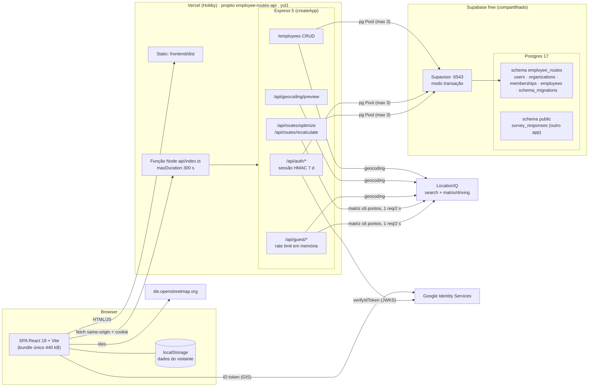

# Auditoria de arquitetura: Employee Routes

- **Data:** 2026-11-27
- **Commit auditado:** `4360bf2` (branch `main`)
- **Escopo:** repositório inteiro (backend `src/` e `api/`, frontend `frontend/`, docs, configuração de deploy), mais leituras **somente de metadados** no Supabase (catálogo do Postgres, advisors) e na Vercel (projeto, nomes das variáveis sem descriptografar, erros de runtime dos últimos 7 dias). Nenhum código, dado ou configuração foi alterado.

---

## 1. Resumo executivo

O núcleo de domínio (agrupamento e roteamento) é bem tipado, bem testado e mais robusto do que o normal para um projeto de treino: separa "rota inexistente" de "falha técnica", valida matrizes e trata 429. Os riscos estão **em volta** desse núcleo:

1. **O gargalo da otimização é I/O, não CPU.** Medi com um provider falso: 40 funcionários fazem 216 chamadas de matriz à LocationIQ e usam ~29 ms de CPU. Como o provider espaça as chamadas em 2 s, isso dá cerca de 7 min, acima dos 300 s da função. Acima de ~25 funcionários a otimização autenticada provavelmente estoura o timeout.
2. **Qualquer conta Google cria uma organização e consome a cota paga/limitada** (LocationIQ, horas de função da Vercel). Não há convite, cota nem papéis aplicados (ADMIN/OPERATOR existem só no banco).
3. **Os deploys de preview usam o mesmo `DATABASE_URL` e o mesmo `SESSION_SECRET` da produção.** Qualquer branch publicada roda contra os dados reais, e um token emitido em preview vale em produção.
4. **A suíte de testes engana:** `npm test` roda 9 de 17 arquivos. Dois arquivos que passam ficam de fora e 4 arquivos `*.test.ts` são scripts manuais que falham sem a chave da LocationIQ.
5. **Plataforma:** o Supabase free pausa e não tem backup, o plano Hobby da Vercel não permite uso comercial, não há CI e a observabilidade se resume a `console.error`.

Não encontrei vazamento entre organizações: todas as queries filtram por `organization_id`, e o schema `employee_routes` está bem isolado no banco. Mas o isolamento depende 100% do código da aplicação (RLS desligado e sem teste com banco real).

---

## 2. Arquitetura atual

**Fluxo da otimização** (`src/optimization/employee-route-optimization.service.ts`):

1. `ExecutionRoutingProvider.prepare` busca matrizes em lotes de origem + 5 funcionários ordenados por distância.
2. É verificado se cada funcionário tem rota a partir da empresa.
3. `createCandidateGroups` insere os funcionários de forma gulosa, um por um, no grupo com o maior score. Cada avaliação pede uma matriz de até 5 pontos e testa até 4! = 24 permutações.
4. Para cada grupo, a melhor ordem de paradas é escolhida por score.

Todas as chamadas à LocationIQ passam por uma fila serial com espaçamento de 2 s (`locationiq-routing.provider.ts:26-42`).

---

## 3. Resultados das verificações executadas

| Comando | Raiz | Frontend |
|---|---|---|
| `npm ci` | ok (123 pacotes) | ok (134 pacotes) |
| `npm run typecheck` | ok | ok |
| `npm test` | **67/67 ok**, mas só 9 de 17 arquivos | **35/35 ok** (12 arquivos) |
| arquivos de teste fora do script | `optimization-behavior.config.test.ts` (8 ok), `manual-route.unit.test.ts` (2 ok), `grouping.test.ts` (1 ok), `road-compatibility.test.ts` (1 ok); **falham:** `group-compatibility.test.ts`, `group-candidate-evaluator.test.ts`, `routing.test.ts` (exigem `LOCATIONIQ_API_KEY` real), `final-optimization.test.ts` (exige SQLite populado) | n/a |
| cobertura (`node --experimental-test-coverage`) | 89,6 % linhas, 87,9 % branches no conjunto do `npm test`. Baixa em `postgres-repositories.ts` (30 %), `geocoding.service.ts` (35 %), `manual-route.service.ts` (37 %). `postgres-migrations.ts` e `runtime.ts` nunca são carregados | sem ferramenta de cobertura instalada |
| `npm audit` | 3: **critical** `proxy-addr`, **high** `body-parser`, moderate `qs` (todos resolvíveis com `npm audit fix`) | 4: high `vite` 8.3.0, high `source-map-js`, moderate `vitest`/`@vitest/mocker` (só dev/build) |
| `npm run build` (frontend) | n/a | ok: JS 439,7 kB (132,9 kB gzip), CSS 41,4 kB, **um único chunk** |
| Varredura de segredos no `git log -p` | nenhuma chave LocationIQ, URL Postgres com senha ou client secret encontrada | n/a |

**Medição de chamadas à LocationIQ por otimização.** Provider falso que conta requisições, perfil NORMAL, script em `scratchpad/count-calls.mts`, não versionado:

| Cenário | Chamadas de matriz | Grupos | CPU | Tempo de parede estimado (espaçamento de 2 s) |
|---|---:|---:|---:|---:|
| Dataset visitante (12) | 8 | 3 | 9 ms | ~16 s |
| Sintético 20 (raio ~22 km) | 65 | 9 | 18 ms | ~2,2 min |
| Sintético 40 | 216 | 15 | 29 ms | **~7,2 min, acima dos 300 s** |
| Sintético 80 | 311 | 23 | 41 ms | ~10,4 min |

Os números exatos dependem da distribuição geográfica. A forma da curva (≈ O(n·g) chamadas, cada uma com custo fixo de 2 s) não depende.

**Estado real verificado na plataforma (somente leitura):**

- **Supabase.** As 5 tabelas estão em `employee_routes`, com dono `employee_routes`. A role tem `search_path=employee_routes` e `statement_timeout=60s`, **não pode criar em `public`** e tem RLS desligado nas próprias tabelas. Os índices batem com a migration v1. O advisor de segurança só aponta itens do outro app (`public.rls_auto_enable` SECURITY DEFINER executável por `anon`, proteção contra senha vazada). Fica registrado, mas fora do escopo: não toco em `public`.
- **Vercel.**
  - Projeto em Node 24.x. Não existem `GOOGLE_CLIENT_ID`, `FRONTEND_ORIGIN` nem `NODE_ENV` explícitos.
  - `VITE_GOOGLE_CLIENT_ID` existe **só em production**.
  - `DATABASE_URL` e `SESSION_SECRET` valem em **production e preview**.
  - `VITE_API_URL` continua cadastrada.
  - `DATABASE_POOL_MAX=3`.
  - SSO protection está ativa apenas nos previews.
  - Erros de runtime em 7 dias: `AUTH_CONFIGURATION_ERROR` e um `STARTUP_DATABASE_ERROR` cuja mensagem é, na verdade, de configuração do Google (ver A-06 e O-05).

---

## 4. Tabela de achados

Severidade: **crítica** = perda/vazamento de dados ou indisponibilidade provável já; **alta** = quebra previsível em uso real ou abuso fácil; **média** = dívida que custa caro em breve; **baixa** = higiene.

### 4.1 Segurança

| ID | Área | Sev. | Evidência | Impacto | Sugestão |
|---|---|---|---|---|---|
| S-01 | Plataforma/segredos | **alta** | Vercel: `DATABASE_URL` e `SESSION_SECRET` com target `production`+`preview` | Qualquer branch publicada (incluindo código experimental) lê e escreve os dados reais. Um token emitido por um preview é aceito em produção, porque o segredo é o mesmo | Banco separado para preview (Supabase branch ou schema `employee_routes_preview` com outra role) e `SESSION_SECRET` diferente por ambiente |
| S-02 | AuthZ / custo | **alta** | `postgres-repositories.ts:91-96` (todo login novo vira ADMIN de uma org nova); nenhuma checagem de `role` em `src/` | Qualquer conta Google do mundo usa geocoding e otimização, queimando a cota da LocationIQ e as horas de função da Vercel. ADMIN/OPERATOR são decorativos | Cadastro por convite/allowlist de domínio, autorização por papel (`requireRole`) e cota por organização |
| S-03 | Sessão | **média** | `session-token.ts:20-24` (payload só `sub`/`exp`); `auth.routes.ts:34-38` | Logout só apaga o cookie: um token copiado vale 7 dias. Não há como revogar uma sessão nem girar o segredo sem derrubar todos | Tabela `sessions` (id aleatório e hash, `revoked_at`) ou `session_version` por usuário verificado a cada request (já existe 1 query por request) |
| S-04 | Sessão | **média** | `auth.service.ts:25-27`; `auth.routes.ts:18-19`; `docs/optimization-api.md:25-27` | O ID token do Google continua aceito como bearer, e sem `SESSION_SECRET` o próprio ID token vai para o cookie. Isso amplia a superfície e mantém um caminho legado vivo | Aceitar só o token de sessão. Sem `SESSION_SECRET`, falhar no boot |
| S-05 | CSRF/cookie | **média** | `auth.routes.ts:16,35`: `SameSite=None` em produção | O app hoje é same-origin, mas o cookie viaja em requests cross-site. A proteção contra CSRF existe por acidente (o body só é lido como `application/json`, o que força preflight). `POST /api/auth/logout` é forjável por formulário | `SameSite=Lax` (ou `Strict`), prefixo `__Host-`, e checagem de `Origin`/`Sec-Fetch-Site` em métodos de escrita |
| S-06 | Headers | **média** | `vercel.json` sem `headers`; `app.ts` sem helmet | Sem CSP, HSTS explícito, `X-Frame-Options`/`frame-ancestors`, `Referrer-Policy` ou `X-Content-Type-Options` | Bloco `headers` no `vercel.json` com CSP que libere GIS, tiles do OSM e LocationIQ (apenas via backend) |
| S-07 | Validação de input | **média** | `employee.routes.ts:36-39,73-74`: só checa truthiness de `name/address/phone` | Aceita números, objetos e arrays (gravados como `[object Object]`/JSON), sem limite de tamanho. `address` não-string segue para a URL do geocoding | Schema de validação (zod/valibot) por rota com tipos e tamanhos, compartilhado com o frontend |
| S-08 | Abuso/DoS | **média** | `optimization.routes.ts:207-216` sem limite de `employeeIds`; `recalculate` sem limite de grupos | Um usuário autenticado dispara otimizações de minutos e centenas de chamadas pagas | Máximo por execução (por ex. 60), 1 execução concorrente por org e cota diária |
| S-09 | Dependências | **média** | `npm audit`: `proxy-addr` (crítica), `body-parser` (alta), `qs` | `proxy-addr` só é explorável com `trust proxy` (não usado). `body-parser` é DoS com corpo comprimido. Mesmo assim, manter crítica aberta é má prática | `npm audit fix` e Dependabot/Renovate |
| S-10 | Dependências (dev) | **baixa** | `frontend` audit: `vite` 8.3.0, `source-map-js`, `vitest` 5.0.1 | Afeta o dev server e o build, não o bundle servido | Atualizar `vite` para 8.4+ e `vitest` para 5.1+ |
| S-11 | Exportação | **baixa** | `frontend/src/lib/route-export.ts:70-73` | Injeção de fórmula em CSV: um nome como `=HYPERLINK(...)` vira fórmula ao abrir no Excel (relevante para a área de Qualidade) | Prefixar `'` em células que comecem com `= + - @` |
| S-12 | Segredos em URL | **baixa** | `geocoding.service.ts:25-34`, `locationiq-routing.provider.ts:61-66` | A LocationIQ exige `key` na query. O código já redige URLs nos logs (`external-provider.logging.ts`), mas um proxy ou APM futuro pode registrar a URL | Manter a redação e documentar que a URL nunca pode ir para logs ou spans |

### 4.2 Multi-tenancy e dados

| ID | Área | Sev. | Evidência | Impacto | Sugestão |
|---|---|---|---|---|---|
| D-01 | Isolamento | **média** | Todas as queries filtram `organization_id` (`postgres-repositories.ts:26-56`). RLS desligado nas tabelas (catálogo Supabase). Testes de isolamento usam mock (`auth.http.test.ts:12-22`) | **Nenhum vazamento encontrado**, mas a garantia é só de código e não tem teste contra Postgres real. Uma query nova sem filtro vaza dados | Teste de integração de isolamento com Postgres real. Opcional: RLS com `SET LOCAL app.org_id` dentro de transação (compatível com o pooler em modo transação) |
| D-02 | Modelo | **média** | `postgres-migrations.ts:24-30,32-42`; `postgres-repositories.ts:85,110-112` | O usuário só enxerga a primeira membership (`ORDER BY created_at LIMIT 1`). Não há convite, troca de org nem unicidade de nome/telefone. `id` é `TEXT` em vez de `uuid` | Tabela `invitations` e seleção de org ativa na sessão |
| D-03 | Modelo de domínio | **média** | `company/company.config.ts:3-9` (coordenada única e global); `optimization.routes.ts:239,285` | Toda organização parte do mesmo ponto (a empresa). O multi-tenant é incompleto: outra empresa ou outra filial não funciona | Tabela `sites`/`locations` por organização. A otimização recebe `originId` |
| D-04 | Concorrência | **baixa** | `postgres-repositories.ts:79-97`: SELECT e depois INSERT sem `ON CONFLICT` | Dois primeiros logins simultâneos da mesma conta geram violação de `users_google_subject_key` e 503 | `INSERT ... ON CONFLICT (google_subject) DO UPDATE ... RETURNING` |
| D-05 | Histórico | **média** | Não há tabela de execuções. O resultado vive só no estado React (`RoutesPage.tsx:125-138`) | Recarregar a página perde o resultado. Sem auditoria de quem gerou qual rota e quando, o que importa para a Qualidade | Tabela `optimization_runs` (input, config, resultado, autor, duração, chamadas externas) |
| D-06 | Backup | **alta** | Supabase free (sem backups diários nem PITR); sem `pg_dump` agendado | Histórico já mostra perda total de dados (Railway). Repetir aqui é questão de tempo | `pg_dump` do schema `employee_routes` agendado (GitHub Actions) para armazenamento externo, com restauração testada |

### 4.3 Confiabilidade

| ID | Área | Sev. | Evidência | Impacto | Sugestão |
|---|---|---|---|---|---|
| R-01 | Execução longa | **crítica** | `locationiq-routing.provider.ts:29-31` (`nextRequestAt = now + 2000`); medição da seção 3; `vercel.json` `maxDuration: 300` | Com ~25 ou mais funcionários a requisição passa de 300 s: a função morre, o usuário espera minutos e recebe erro, e as chamadas já feitas são desperdiçadas | Job assíncrono (202 + polling/SSE) e cache de matriz (ver P-01/P-02). Rever o espaçamento conforme o limite real do plano |
| R-02 | Timeouts | **alta** | `geocoding.service.ts:33` e `locationiq-routing.provider.ts:30` com `fetch` sem `AbortSignal`; `frontend/src/services/api.ts:43` idem | Uma LocationIQ lenta prende a função até o `maxDuration`. O navegador não tem limite nem cancelamento | `AbortSignal.timeout(10_000)` por chamada, orçamento total por execução e `AbortController` no frontend |
| R-03 | Retry | **média** | `locationiq-routing.provider.ts:32`: retry só em 429 (3 tentativas), nada em 5xx ou erro de rede. Geocoding sem retry | Uma falha transitória derruba a execução inteira (216 chamadas, uma falha, perda total) | Retry com backoff exponencial e jitter em 429/5xx/rede, com teto, e idempotência por célula da matriz |
| R-04 | Cota global | **alta** | Provider instanciado por request (`optimization.routes.ts:195`, `guest.routes.ts:95`); fila e espaçamento são por instância | Duas execuções simultâneas, ou várias instâncias serverless, ultrapassam o limite da LocationIQ juntas. Não há contador de cota diária | Limitador distribuído (Postgres ou Redis) e orçamento diário com alerta |
| R-05 | Migrations no boot | **média** | `api/index.ts:14`; `runtime.ts:7`; `postgres-migrations.ts:51-69` sem `pg_advisory_lock` | Cada cold start faz 2 round-trips de DDL/SELECT. Dois cold starts simultâneos aplicando uma migration nova disputam a criação e um responde 503. DDL fica acoplado ao tráfego | Migrations como passo de deploy (CI), com lock e versionamento formal. O runtime só verifica a versão |
| R-06 | Tratamento de erro | **média** | `manual-route.service.ts:33,36,49,52` (`throw new Error`), mapeado para 500 em `optimization.routes.ts:189` | Um `stopOrder` inválido no `/recalculate` autenticado vira 500 `INTERNAL_ERROR` em vez de 400. O guest valida antes, o autenticado não | Validar `stopOrder` na rota (como `guest.routes.ts:85-87`) e usar erros tipados |
| R-07 | Erros por string | **baixa** | `auth.middleware.ts:20` (`message.includes("no local account")`); `optimization.routes.ts:236,249` (`startsWith("Unknown employee IDs:")`) | Mudar o texto da mensagem quebra o status HTTP em silêncio | Classes de erro (`UnknownAccountError`, `EmployeeNotFoundError`) |
| R-08 | UX de erro | **média** | `frontend/src/pages/RoutesPage.tsx:159` (`try/finally` sem `catch`); `ManualRouteEditor.tsx:13` chama `onSave` sem `await` | Se o recálculo manual falhar, a promise é rejeitada sem tratamento e o usuário não vê nenhuma mensagem | Capturar o erro e exibi-lo no editor |
| R-09 | Dedup | **baixa** | `optimization.routes.ts:197`: `inFlight` em memória | O dedup só vale dentro da mesma instância. Não funciona entre instâncias nem entre retries do cliente | Chave de idempotência persistida em `optimization_runs` |

### 4.4 Desempenho

| ID | Área | Sev. | Evidência | Impacto | Sugestão |
|---|---|---|---|---|---|
| P-01 | Chamadas externas | **alta** | `execution-routing.provider.ts:19-30,71-85`: cache só por execução; `group-candidate-evaluator.service.ts:52` pede matriz por avaliação | ≈O(n·g) chamadas: 65 com 20 funcionários, 216 com 40. Nada é reaproveitado entre execuções, embora endereços mudem pouco | Cache persistente de células `(from,to)` por coordenada arredondada, com TTL de dias. Pré-buscar a matriz N×N em blocos (a LocationIQ aceita `sources`/`destinations`) para ter custo ≈ ⌈n/k⌉² chamadas |
| P-02 | Algoritmo | **baixa** | `grouping.service.ts:134-249` (inserção gulosa por ordem de distância); `permutation.utils.ts` (≤24 permutações) | A CPU é irrelevante (<50 ms com 80 funcionários). O guloso depende da ordem e não revisita decisões, então pode deixar grupos de 1 que um ajuste local resolveria | Depois de resolver o I/O: busca local (2-opt/troca entre grupos) sobre a matriz completa em cache |
| P-03 | Cold start | **baixa** | `src/app.ts:81` (app padrão no import); `api/index.ts:14` (migrations); import de `google-auth-library` | Cada cold start cria 3 objetos `Pool` extras (sem conexões), executa migrations e pode registrar `AUTH_CONFIGURATION_ERROR` falso | Remover o app de módulo e mover as migrations para o deploy |
| P-04 | Bundle | **média** | Build: um chunk de 439,7 kB / 132,9 kB gzip; `App.tsx:6` importa o CSS do Leaflet globalmente; mapas importados estaticamente | O primeiro carregamento no celular inclui Leaflet mesmo na tela de login | `React.lazy` para `RouteMap`/`EmployeeLocationMap` e as páginas. Meta: <200 kB no carregamento inicial |
| P-05 | Rede (frontend) | **baixa** | `App.tsx:19-20`, `RoutesPage.tsx:144`, `EmployeesPage.tsx:129`: três `listEmployees` independentes | Requests duplicados e contagem que pode divergir | Cache de dados (TanStack Query) ou um contexto único |

### 4.5 Arquitetura e código

| ID | Área | Sev. | Evidência | Impacto | Sugestão |
|---|---|---|---|---|---|
| A-01 | Composição | **média** | `src/app.ts:24-34,81-82`; `employee.routes.ts:23`; `optimization.routes.ts:194`; `postgres-repositories.ts:24,73` | Os módulos constroem as próprias dependências (`createDefault*`, `new Pool()` como valor default). O import de `app.js` tem efeito colateral. Há dois caminhos de composição (`createApp()` padrão e `buildApp`) | Um único *composition root* (`createRuntime(config)`), sem defaults que abrem recursos. Routers recebem só interfaces |
| A-02 | Entrypoints | **média** | `src/server.ts:21-41` × `api/index.ts:12-28` | Mesma montagem duplicada com regras diferentes: `server.ts` derruba sem Google, `api/index.ts` degrada; `server.ts` cai para SQLite em dev | `buildApp(config)` compartilhado. Cada entrypoint vira um adaptador de ~5 linhas |
| A-03 | Código legado | **média** | `database/database.ts`; `employee-repository.ts:6-59`; `employeeStore` em `employee.routes.ts:13` e `optimization.routes.ts:32`; `optionalDependencies.better-sqlite3`; `.env.example` `DATABASE_PATH`; tenant `"legacy"` em `employee.routes.ts:18`, `optimization.routes.ts:226,263` | Um segundo backend de dados sem tenant convive com o real. Os testes HTTP de funcionários exercitam o SQLite falso, não o repositório de produção | Remover e migrar os testes para um repositório em memória que implemente `EmployeeRepository`, mais integração com Postgres |
| A-04 | Código morto | **baixa** | `routing/routing.service.ts` (0 bytes); `route-optimizer.service.ts:9-39` (`findFastestRoute` com `console.log`); `grouping.config.ts:3` `preferredBearingDifference`; `optimization/grouping.config.test` (arquivo sem extensão); `frontend/src/lib/route-utils.ts:3` `resultCounts`; `formatters.ts:12` `formatExtraDuration`; `route-export.ts:61` `finalRoutes`; `services/api.ts:11-13` `setApiAuthToken` (nunca recebe token) | Ruído e falsa sensação de suporte | Apagar ou mover para `scripts/` |
| A-05 | Regras de negócio | **média** | `route-constraints.service.ts:17` usa sempre 15 min fixos; `optimization-behavior.config.ts:7` | O perfil CUSTOM com "maior desvio 40 min" continua marcando REJECTED a partir de 15 min. A UI mostra o limite configurado mas aplica outro (é intencional, mas confunde o operador) | Usar o limite do perfil ou deixar explícito na UI que o aceite é fixo em 15 min |
| A-06 | Configuração | **média** | `server.ts:6-14` valida só 4 variáveis e só em produção; `api/index.ts` não valida; `google-auth.service.ts:24` cai para `VITE_GOOGLE_CLIENT_ID`; `DATABASE_POOL_MAX` sem validação numérica (`postgres-repositories.ts:9`) | Configuração errada aparece em runtime, na primeira request. Ex.: preview sem `VITE_GOOGLE_CLIENT_ID` gera os erros vistos nos logs | Módulo `config.ts` com schema (zod), validado no boot, falha rápida, tipado e único |
| A-07 | Consistência de API | **baixa** | `employee.routes.ts:30,39,74,83` (`{error:"..."}` e `{message:"..."}`) × resto (`{error:{code,message}}`); PUT sem campos responde "Address not found." (`:39`) | O frontend precisa de heurísticas por rota (`services/api.ts:22-38`) | Envelope de erro único e um contrato OpenAPI |

### 4.6 Qualidade e DX

| ID | Área | Sev. | Evidência | Impacto | Sugestão |
|---|---|---|---|---|---|
| Q-01 | Testes | **alta** | `package.json` `scripts.test` lista 9 arquivos; 8 outros ficam de fora (seção 3) | Testes que passam (config de perfis, recálculo manual) não protegem nada. 4 "testes" quebrados mascaram a suíte real | Glob `src/**/*.test.ts`. Mover os scripts que usam a API real para `scripts/` ou `*.live.ts` com opt-in |
| Q-02 | Testes de integração | **alta** | `postgres-repositories.ts` 30 % de cobertura; migrations 0 % | SQL, migrations e isolamento por tenant nunca rodam em teste | Testcontainers (ou serviço Postgres no CI) com testes de repositório e isolamento |
| Q-03 | E2E | **média** | Inexistente | O fluxo login → cadastro → otimização → mapa não é verificado | Playwright contra o build, com LocationIQ simulada |
| Q-04 | CI | **alta** | Sem `.github/` | Nada impede um merge que quebra typecheck ou testes. O deploy da Vercel acontece de qualquer jeito | GitHub Actions: typecheck, test, build e audit nos dois pacotes, exigido no PR |
| Q-05 | Lint/format | **média** | Sem ESLint/Prettier/Biome; estilos misturados (indentação de 4 e 2 espaços, linhas de mais de 400 caracteres em `ManualRouteEditor.tsx:16`, `RoutesPage.tsx:160`) | Revisão difícil e bugs simples (promise sem tratamento, R-08) passam | Biome ou ESLint com `typescript-eslint` (`no-floating-promises`) e Prettier |
| Q-06 | Tipagem | **baixa** | Backend `strict` com `exactOptionalPropertyTypes`. Frontend `strict` sem `noUncheckedIndexedAccess`. `tsconfig.json` raiz com comentários do template | Tipagem boa no geral. O frontend é um pouco mais frouxo | Alinhar flags, limpar o tsconfig e compartilhar tipos de contrato entre back e front |
| Q-07 | Documentação | **média** | `README.md:29,62-66,72` (SQLite, `VITE_API_URL`, "domínios diferentes"); `docs/v1.3-authentication.md:9,15,24` (Railway, ID token no cookie); `docs/optimization-api.md:25-27` (Bearer Google); `frontend/src/services/api.ts:3-4` (Railway); `frontend/README.md:31` (diz que não há edição manual, mas há) | Quem chega novo configura o ambiente errado | Reescrever o README (arquitetura, setup, variáveis, deploy) e adicionar ADRs curtos |

### 4.7 Frontend

| ID | Área | Sev. | Evidência | Impacto | Sugestão |
|---|---|---|---|---|---|
| F-01 | Estado/navegação | **média** | `App.tsx:14` (página em `useState`); sem router | Sem URL por tela, o botão voltar não funciona e não dá para compartilhar o link de uma execução | Router leve e URL por execução (depende de D-05) |
| F-02 | Acessibilidade | **média** | `RoutesPage.tsx:185`: prévia Uber em `div role="dialog"`, sem foco inicial, sem trap, sem Esc (o resto usa `<dialog>`, `Modal.tsx`); `RouteMap.tsx` sem alternativa textual além dos cards; seleção de exportação via `<select>` dentro de `<label class=button>` | Usuários de teclado e leitor de tela ficam presos ou perdidos | Reusar `Modal`, auditar com axe no E2E |
| F-03 | Mobile | **baixa** | `styles.css:205-298` com breakpoints 1100/760/430 e screenshots mobile em `frontend/docs/screenshots` | Responsividade tratada. O editor manual com `<select>` por parada é denso no celular | Validar no E2E com viewport mobile |
| F-04 | Tiles | **baixa** | `RouteMap.tsx:37`, `EmployeeLocationMap.tsx:27`: `tile.openstreetmap.org` | A política de uso do OSM não garante SLA e desencoraja uso comercial intenso | Usar um provedor de tiles (MapTiler, Stadia, ou tiles da própria LocationIQ) se a Florarte adotar |
| F-05 | Feedback de longa duração | **média** | `RoutesPage.tsx:45` promete "1–2 minutos"; nenhum cancelamento | A expectativa não bate com a realidade (até 5 min e depois erro) | Progresso real via job assíncrono e botão cancelar |

### 4.8 Operação e plataforma

| ID | Área | Sev. | Evidência | Impacto | Sugestão |
|---|---|---|---|---|---|
| O-01 | Licença de uso | **alta** | Vercel Hobby (projeto em team pessoal) | Os termos do Hobby restringem a uso não comercial. Uso operacional pela Florarte exige Pro (~US$ 20/mês por membro) ou outro host | Decidir antes da adoção (Fase 2 traz comparação) |
| O-02 | Disponibilidade do banco | **alta** | Supabase free: pausa após ~7 dias sem atividade; sem backup (D-06); projeto compartilhado com outra aplicação | Na primeira semana de férias da equipe o app fica fora. Uma restauração manual pode levar minutos. O outro app concorre pelos mesmos limites (500 MB, conexões) | Supabase Pro (~US$ 25/mês) ou outro Postgres gerenciado, ou no mínimo um keep-alive e backup externo |
| O-03 | Observabilidade | **alta** | Só `console.*` com objetos soltos (`api/index.ts:39`, `app.ts:76`, `grouping.service.ts:199`, `execution-routing.provider.ts:60`); sem request-id, sem métricas, sem alertas | Não dá para responder quantas otimizações falharam ontem, quanto tempo levam ou quantas chamadas à LocationIQ foram feitas | Logger JSON (pino) com `requestId`/`orgId`/`runId`, métricas por execução, Sentry (free) e alerta de cota |
| O-04 | Rollback/deploy | **média** | Deploy automático da `main` na Vercel; migrations no runtime | O rollback de código é instantâneo (Vercel), mas uma migration já aplicada não volta. Não há gate de CI antes do deploy | Migrations expand/contract, checks obrigatórios no GitHub antes do deploy, preview com banco próprio (S-01) |
| O-05 | Log enganoso | **baixa** | `api/index.ts:37-39` registra qualquer falha de init como `STARTUP_DATABASE_ERROR`; os logs reais mostram erro de Google com esse rótulo | Diagnóstico errado durante incidente | Rotular pela causa |
| O-06 | Variáveis sobrando | **baixa** | Vercel: `VITE_API_URL` (production+preview); `frontend/.env.example:2`; `api.ts:7-9` só a usa em DEV | Ruído e confusão sobre a arquitetura (sugere backend separado) | Remover da Vercel (**precisa da sua confirmação**) e do `.env.example`. Usar o proxy do Vite em dev |
| O-07 | Variáveis por ambiente | **média** | `VITE_GOOGLE_CLIENT_ID` só em production; backend usa esse fallback (`google-auth.service.ts:24`) | Preview sem login (origem dos erros de runtime atuais) | `GOOGLE_CLIENT_ID` explícito no backend e client ID de preview (ou origem autorizada) |
| O-08 | Custos/limites | **média** | LocationIQ free (≈5.000 req/dia e ≈2 req/s, segundo a página de preços na data do meu conhecimento; **confirmar o plano atual**); Vercel Hobby (CPU ativa e memória provisionada mensais limitados) | Com 216 chamadas por execução de 40 pessoas, cabem cerca de 23 execuções/dia no free. Funções de 300 s consomem memória provisionada rápido | Cache (P-01) e cota (R-04) antes de escalar. Monitorar o uso |

---

## 5. Veredito sobre os 10 pontos suspeitos

| # | Suspeita | Veredito | Evidência e nuance |
|---|---|---|---|
| 1 | `createApp()` no nível do módulo gera pools extras; dois entrypoints duplicados | **Confirmado, com impacto menor que o esperado** | `src/app.ts:81` executa no import feito por `api/index.ts:3`. Com `DATABASE_URL` definida, cria `PostgresAuthRepository`, `createDefaultEmployeeRepository()` duas vezes (employees e optimization), ou seja **3 `Pool` extras**, além do pool real de `runtime.ts:6`. O `pg.Pool` é preguiçoso: **não abre conexões** enquanto ninguém faz query, então não esgota o pooler. O dano real é efeito colateral no import (os `AUTH_CONFIGURATION_ERROR` dos logs da Vercel vêm daí) e confusão. A duplicação `server.ts`/`api/index.ts` é real e as regras divergem (A-02) |
| 2 | Migrations caseiras no cold start, sem rollback nem versionamento formal | **Confirmado** | `postgres-migrations.ts:3-69`: array em código, só `up`, transação por migration (bom), **sem advisory lock** (corrida entre cold starts), DDL disparado pelo tráfego (`api/index.ts:14`). Versionamento existe (`schema_migrations`), mas sem checksum, sem `down` e sem execução no CI (R-05) |
| 3 | Fallback SQLite/legado ainda no código | **Confirmado** | `database/database.ts`, `LegacyEmployeeRepository` (`employee-repository.ts:14-48`), `optionalDependencies.better-sqlite3`, `@types/better-sqlite3`, `server.ts:25-27`, tenant `"legacy"`. Os testes HTTP de employees ainda passam por ele (`employee.http.test.ts:7-34`) e `final-optimization.test.ts` depende de um `.sqlite` local (A-03) |
| 4 | Rate limit do visitante em memória não funciona entre instâncias | **Confirmado, e é pior** | `guest.routes.ts:98-99` usa `Map` por instância, nunca podado (cresce sem limite). Além disso, sem `app.set("trust proxy")` (nenhuma ocorrência em `src/`), `request.ip` é o endereço do socket da plataforma, não do cliente. **Provavelmente** todos os visitantes compartilham o mesmo bucket por instância, e um abusador bloqueia o modo visitante para todos. Isso precisa ser confirmado logando `request.ip` num preview. Habilitar `trust proxy` exige antes corrigir o `proxy-addr` (S-09) |
| 5 | Otimização CPU-bound de minutos numa função síncrona; LocationIQ sem cache, retry/backoff ou cota | **Parcialmente confirmado, com correção importante** | **Não é CPU-bound:** 80 funcionários usam ~41 ms de CPU (seção 3). O tempo vem do espaçamento serial de 2 s (`locationiq-routing.provider.ts:29-31`) multiplicado por ≈O(n·g) chamadas. É síncrono e pode passar de 300 s (confirmado, R-01). **Cache:** existe, mas só dentro de uma execução (`ExecutionRoutingProvider`); entre execuções não há (P-01). **Retry/backoff:** existe para 429 (3 tentativas, `Retry-After`, exponencial), não para 5xx/rede/timeout (R-03). **Cota:** não existe controle global nem diário (R-04) |
| 6 | Sessões stateless sem revogação; ID token Google aceito como bearer; nome do cookie desatualizado | **Confirmado (os três)** | `session-token.ts` (só `sub`/`exp`); logout (`auth.routes.ts:34-38`) só expira o cookie; `auth.service.ts:25-27` aceita ID token; cookie `employee_routes_google_id` (`auth.routes.ts:20`, `auth.middleware.ts:9`). Mitigação parcial: cada request consulta o usuário no banco, então apagar o usuário revoga o acesso. Achados extras: `SameSite=None` (S-05) e segredo compartilhado com preview (S-01) |
| 7 | `DATABASE_URL` com `sslmode=no-verify` | **Provável; não verificado diretamente** | O valor é `sensitive` na Vercel e **não descriptografei**, por política. O código (`postgres-repositories.ts:9`) não passa a opção `ssl`, então depende só da URL, e não há caminho para fornecer a CA da Supabase. Nas versões recentes do `pg`, `sslmode=require` equivale a `verify-full`, que falha contra o certificado do pooler sem a CA. Isso costuma empurrar para `no-verify`, compatível com a suspeita. Correção: `ssl: {ca: SUPABASE_CA_PEM, rejectUnauthorized: true}`. Confirmar o valor exige você olhar a variável |
| 8 | Sem CI, observabilidade, testes de integração com banco real ou E2E | **Confirmado** | Sem `.github/`; logs só via `console`; `postgres-repositories.ts` com 30 % de cobertura (via mocks) e migrations com 0 %; sem Playwright. Agravante: o próprio `npm test` deixa 8 arquivos de fora (Q-01) |
| 9 | Supabase free pausa, Vercel Hobby proíbe uso comercial, sem backup | **Confirmado** | Supabase em plano free (projeto único, criado em 2026-11-08) e compartilhado com `public.survey_responses`; sem backup/PITR no free. Projeto Vercel numa team Hobby pessoal. Os limites e preços exatos devem ser reconfirmados nas páginas oficiais antes da decisão (Fase 2) |
| 10 | Configuração não validada no boot; `VITE_API_URL` sobrando | **Confirmado** | `server.ts:6-14` valida parcialmente e só em produção; `api/index.ts` só checa `DATABASE_URL`; `DATABASE_POOL_MAX`, `SESSION_SECRET` (tamanho mínimo) e `LOCATIONIQ_API_KEY` não são validados no boot da função. `VITE_API_URL` continua na Vercel (production+preview), no `frontend/.env.example`, no README e nos docs, mas só é lida em DEV (`api.ts:7-9`) |

---

## 6. Pontos fortes (para preservar)

- O domínio de roteamento distingue **ausência de rota confirmada** (`null`, `NoTable`/`NoSegment`) de **falha técnica**, e não transforma 401/429/5xx em "incompatível" (`locationiq-routing.provider.ts:79-87`). Isso é correto e raro.
- Validação rigorosa da matriz antes de usar (`routing-validation.service.ts`), além de um snapshot imutável por execução.
- Perfis de otimização validados no servidor com faixas e campos permitidos (`optimization-behavior.config.ts:74-110`).
- O modo visitante não toca no banco e valida o payload com `allowedKeys` e limites de tamanho (`guest.routes.ts:52-73`).
- Segredos fora do bundle e fora do histórico do git. A redação de URLs nos logs de provedores está correta.
- Isolamento no banco bem feito: role dedicada, `search_path` fixo, sem `CREATE` em `public` e `statement_timeout` de 60 s.
- TypeScript estrito no backend (`noUncheckedIndexedAccess`, `exactOptionalPropertyTypes`). O frontend tem testes comportamentais com Testing Library.

---

## 7. O que não foi possível verificar

- O valor real de `DATABASE_URL` (sslmode) e a presença de `NODE_ENV` em runtime: exigiria descriptografar segredos.
- O IP que o Express recebe em `request.ip` na Vercel: exige um deploy de teste.
- O plano e os limites atuais da conta LocationIQ e o consumo real: não há acesso ao painel.
- A cobertura do frontend: `@vitest/coverage-v8` não está instalado e não instalei nada nesta fase.
