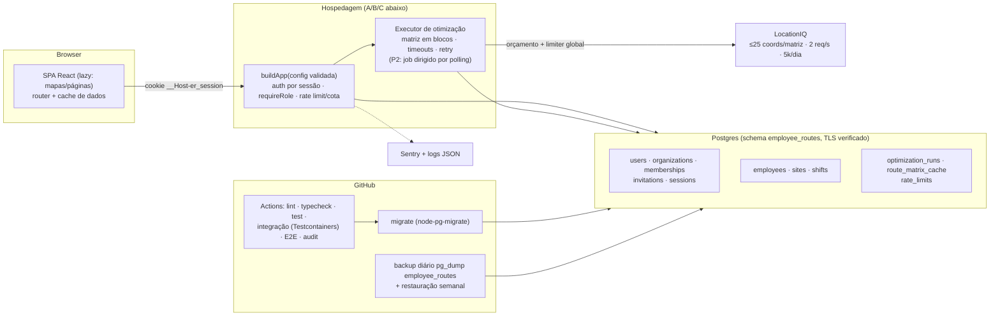
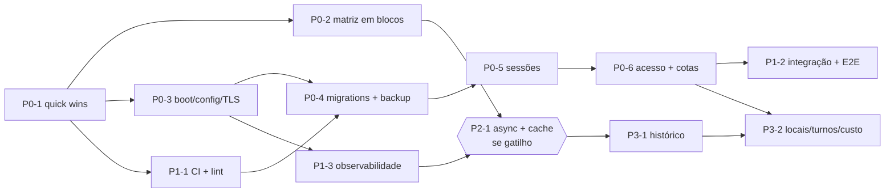

# Roadmap: Employee Routes rumo a produção

- **Base:** [ARCHITECTURE_AUDIT.md](ARCHITECTURE_AUDIT.md) (IDs de achados entre colchetes, ex.: [R-01])
- **Data:** 2026-11-27
- **Regra de execução:** um item = um branch = um PR, na ordem abaixo. Esforço: **P** ≤ 1 dia, **M** 2–4 dias, **G** 1–2 semanas (ritmo de projeto de estudo).

## 0. Decisões

**Confirmadas em 2026-11-27:**
- N = 100, com mínimo obrigatório de 40.
- Cadastro só por convite de ADMIN; a allowlist serve apenas para o primeiro ADMIN.
- Ordem: P0-1 → P1-1 → P0-2 → P0-3 → P0-4 → P0-5 → P0-6 → demais itens.
- O modo preview sem banco entra já no P0-1.
- Testcontainers só no GitHub Actions; fora do CI, os testes de integração são pulados automaticamente.
- No P0-2, se o limite real da matriz ficar abaixo de 12 pontos, parar e consultar antes de seguir.

### Premissas originais (agora confirmadas)

| Decisão | Premissa usada neste roadmap | Como muda se você escolher outra |
|---|---|---|
| **N** (meta de funcionários por otimização) | **N = 100** como meta, **40** como piso obrigatório do aceite | Os critérios de P0-2 e o gatilho de P2-1 usam N. Se N ≤ 40, P2-1 provavelmente sai do roadmap |
| **Cadastro** | **Convite por ADMIN**, com `ADMIN_BOOTSTRAP_EMAILS` (allowlist em variável) usado só para criar o primeiro ADMIN | *Allowlist pura:* P0-6 fica P/M, sem tabela de convites. *Qualquer um com cota diária:* P0-6 mantém a cota e remove o convite, mas o custo de abuso continua possível |

**Por que recomendo convite.** Para uma empresa com uma área (Qualidade) e poucos operadores, convite dá controle por pessoa e se encaixa naturalmente com ADMIN/OPERATOR. O trade-off é mais uma tabela, um fluxo e um e-mail ou link. Allowlist é mais simples, mas toda inclusão vira deploy ou alteração de variável. Cadastro aberto com cota é a opção mais "SaaS", só que ainda deixa qualquer pessoa consumir a cota gratuita da LocationIQ.

---

## 1. Limites reais da LocationIQ (verificados em 2026-11-27)

| Item | Valor | Fonte |
|---|---|---|
| Plano free | **5.000 requisições/dia e 2 requisições/s** | [locationiq.com/pricing](https://locationiq.com/pricing) (via busca, pois o site não é alcançável desta sessão), confirmado por [Capterra](https://www.capterra.com/p/164206/LocationIQ/pricing/) |
| Coordenadas por chamada de matriz | **até 25**, com parâmetros `sources` e `destinations` (índices) | [docs.locationiq.com/reference/matrix](https://docs.locationiq.com/reference/matrix), [docs/matrix-api](https://docs.locationiq.com/docs/matrix-api) |
| Cache de pares requisição/resposta | **free: até 48 h**; pagante: enquanto for cliente. Dados de resposta (ex.: coordenadas geocodificadas) podem ser guardados sem limite | [locationiq.com/tos](https://locationiq.com/tos), [artigo de cache](https://help.locationiq.com/support/solutions/articles/36000216111-can-i-save-addresses-from-api-output-) |
| Contagem da matriz na cota | **não confirmado** na documentação (fontes de terceiros indicam 1 requisição por chamada) | precisa de medição (P0-2, passo 0) |
| Planos pagos | a partir de ~US$ 49/mês (valores variam entre fontes) | [Capterra](https://www.capterra.com/p/164206/LocationIQ/pricing/) (**confirmar no painel**) |

**Pontos que só uma chamada real resolve:** o limite efetivo de coordenadas no *seu* plano (o código usa 6 e cita respostas `TooBig`) e a contagem da matriz na cota. Esta sessão não alcança `locationiq.com` (bloqueio de rede). O passo 0 de P0-2 é um script que você roda localmente com a sua chave, ou eu rodo se você liberar o host e a credencial no ambiente.

## 2. Opções para a otimização caber no tempo

Os números da linha "atual" foram medidos com um provider falso (ver auditoria, seção 3). As opções A e B são calculadas com blocos de ⌊k/2⌋ pontos: cada par de blocos sai em 1 chamada, num total de C(B,2) chamadas para B blocos. O ritmo é de 1 req/s, metade do limite free, deixando folga para o visitante e para outra org.

| Opção | O que muda | 40 funcionários | 100 funcionários | Cota diária (5.000) | Trade-offs |
|---|---|---|---|---|---|
| **Atual** | pares sob demanda, 1 req a cada 2 s | 216 chamadas, **~7,2 min** (timeout) | 554 chamadas, **~18,5 min** | ~23 execuções/dia de 40 | n/a |
| **A. Matriz completa em blocos** (k = 25) | pré-busca a matriz N×N; o agrupamento passa a usar só o cache da execução | **6 chamadas, ~6 s** | **36 chamadas, ~36 s** | ~830 / ~140 execuções | Mudança pequena e local (`ExecutionRoutingProvider`). Continua síncrono |
| A, se o plano limitar k = 6 | idem, com blocos de 3 | 91 chamadas, ~1,5 min | 561 chamadas, **~9,4 min** | ~55 / ~9 | Para 100 não resolve sozinha |
| **B. Cache entre execuções** (Postgres, TTL 48 h no free) | células `(from,to)` por coordenada arredondada (~11 m) | 2ª execução em 48 h: **0 chamadas**; funcionário novo: ~4 chamadas | 0 chamadas; funcionário novo: ~10 chamadas | ganho grande na rotina diária | Os termos do free limitam a 48 h, então o hit rate depende de uso diário. Exige limpeza por TTL |
| **C. Job assíncrono com polling** | `POST` responde 202 com `runId`; o progresso é lido por `GET /runs/:id` | não reduz chamadas | não reduz chamadas | igual à opção usada | Remove o teto de 300 s e permite progresso real e cancelamento. Complexidade maior: estado persistido, retomada, idempotência |

**Recomendação.** Fazer **A já** (P0-2), junto com timeouts e retry. Se k = 25, A sozinha cumpre N = 100 com folga (~36 s) e de forma síncrona. **B + C** ficam em P2-1, com gatilho explícito: o passo 0 mostrar k < 12, ou a meta passar de ~200, ou o consumo diário passar de 50 % da cota.

**Por que essa ordem.** O problema é o número de chamadas, não onde o código roda. Reduzir chamadas é barato e beneficia todas as outras opções. Um job assíncrono sem isso só move a espera de lugar e continua queimando cota.

---

## 3. Itens

### P0: Confiabilidade e segurança

#### P0-1 · Quick wins de segurança e testes (um PR) · **P**
Resolve [S-05 parcial], [S-06], [S-09], [S-10], [S-11] e [Q-01].
- `npm audit fix` nos dois pacotes (vite ≥ 8.4 e vitest ≥ 5.1 no frontend).
- Cookie com `SameSite=Lax`. O nome do cookie não muda aqui, para não deslogar ninguém duas vezes; a troca fica em P0-5.
- Bloco `headers` no `vercel.json`: CSP (self, `accounts.google.com`, tiles do OSM), HSTS, `frame-ancestors 'none'`, `Referrer-Policy`, `X-Content-Type-Options`.
- Neutralizar injeção de fórmula no CSV.
- `npm test` com glob `src/**/*.test.ts`. Mover os 4 scripts que chamam a API real ou o SQLite para `scripts/live/` com nome `*.live.ts` e script `test:live`.

**Aceite:**
- `npm audit --omit=dev` sem high/critical nos dois pacotes.
- `curl -I` no preview mostra os 5 headers.
- Teste unitário: célula `=1+1` sai como `'=1+1`.
- `npm test` executa todos os `*.test.ts` (≥ 79 testes) e passa sem `LOCATIONIQ_API_KEY`.
- Login, mapa e geocoding funcionam no preview com a CSP ativa.

**Depende de:** nada.

#### P0-2 · Otimização sem timeout: matriz em blocos e chamadas resilientes · **M** · *prioridade máxima*
Resolve [R-01], [R-02], [R-03] e [P-01 parcial].
- **Passo 0 (spike):** `scripts/live/locationiq-limits.live.ts` mede o maior k aceito e verifica no painel quanto uma matriz debita da cota. O resultado é registrado em `docs/adr/0001-locationiq-matrix.md`.
- `ExecutionRoutingProvider.prepare` passa a buscar a matriz N×N em blocos de até k coordenadas (`sources`/`destinations`). k e o ritmo vêm de configuração. O agrupamento não faz chamadas fora do `prepare`.
- `fetch` com `AbortSignal.timeout`, retry com backoff exponencial e jitter em 429/5xx/rede (teto de 3), e orçamento total por execução (ex.: 240 s) que aborta com erro claro.
- Limite de funcionários por execução no servidor (`MAX_EMPLOYEES_PER_RUN`, igual a N) e no frontend.
- A métrica `externalCalls` passa a vir na resposta e nos logs.

**Aceite:**
- Teste com provider falso: 40 funcionários com ≤ 10 chamadas e 100 funcionários com ≤ 40 chamadas (k = 25). O mesmo teste parametrizado com k = 6 documenta os números.
- Medição real (script) de 40 funcionários abaixo de 60 s.
- Testes de timeout, retry de 503 e orçamento estourado.
- Resultado de agrupamento idêntico ao atual nos fixtures existentes (sem regressão de qualidade).

**Depende de:** P0-1 (suíte completa rodando). Do passo 0 depende a sua chave.

#### P0-3 · Boot seguro: configuração validada, TLS verificado e uma composição única · **M**
Resolve [A-01], [A-02], [A-03], [A-06], [O-05], [O-06] e os suspeitos 1, 3, 7 e 10.
- `src/config.ts` com schema (zod) validado no boot, com falha rápida. Inclui `SESSION_SECRET` com ≥ 32 bytes, `DATABASE_POOL_MAX` numérico e `GOOGLE_CLIENT_ID` explícito, sem fallback para `VITE_*`.
- **TLS:** nova variável `DATABASE_CA_CERT` (PEM da CA do Supabase), `ssl: {ca, rejectUnauthorized: true}`, e recusa no boot de `sslmode=no-verify` em produção.
- Um único `buildApp(config)`. `server.ts` e `api/index.ts` viram adaptadores. Sai o `createApp()` de módulo.
- Remoção do SQLite/legado. Os testes HTTP passam a usar um repositório em memória que implementa `EmployeeRepository`.
- **Estratégia de preview (decisão definitiva proposta):** *preview sem banco*. Sem `DATABASE_URL`, a API sobe só com `/health` e `/api/guest/*`, e as rotas privadas respondem 503 com código claro. O fluxo com banco é validado no CI com Postgres efêmero (P1-2).

**Aceite:**
- Teste: boot falha com mensagem que nomeia a variável faltante ou inválida.
- Teste de integração: conexão TLS com CA errada falha.
- Em produção, `select ssl, version from pg_stat_ssl where pid = pg_backend_pid()` retorna `ssl = true` com o modo verificado (log no boot).
- `grep -r better-sqlite3` sem resultado.
- Preview sem `DATABASE_URL` serve o modo visitante.

**Confirmação necessária:** criar `DATABASE_CA_CERT`, trocar `sslmode` e remover `DATABASE_URL`/`VITE_API_URL` dos previews e da Vercel (variáveis de produção).

**Por que preview sem banco:** custo zero e risco zero de tocar dados reais. Um segundo banco gratuito também pausaria e duplicaria migrations. O trade-off é que login e CRUD não são testáveis no preview, e o CI cobre essa lacuna.

**Depende de:** P0-1.

#### P0-4 · Dados seguros: migrations no deploy e backup diário testado · **M**
Resolve [R-05], [D-06], [O-04] e o suspeito 2.
- Trocar o runner caseiro por **node-pg-migrate**. Arquivos SQL versionados com `up`/`down`, tabela de controle própria e `pg_advisory_lock`. Baseline: a migration v1 atual é marcada como aplicada, sem DDL novo.
- `npm run migrate` roda no GitHub Actions antes do deploy de produção. O runtime só verifica se a versão esperada foi aplicada e, se não foi, responde 503 com log claro.
- Convenção expand/contract documentada: nenhuma migration destrutiva sem um PR anterior que pare de usar a coluna.
- Workflow agendado (diário): `pg_dump --schema=employee_routes` (nunca `public`), cifrado com `age`, guardado como artefato privado com retenção de 30 dias. Outro job semanal restaura num Postgres efêmero e roda smoke tests.

**Aceite:**
- Cold start não executa DDL (verificável por log ou por um teste com spy no pool).
- `migrate down` e `up` funcionam no CI.
- Existe um backup do dia e o job de restauração está verde.
- `RUNBOOK.md` com o passo a passo de restauração.

**Confirmação necessária:** segredo `DATABASE_URL` de migração no GitHub, com role que já é a dona do schema.

**Trade-off:** node-pg-migrate em vez de Prisma ou Drizzle. Mantém o SQL puro que você já escreve e não muda a camada de acesso. Em troca, não gera tipos.

**Depende de:** P0-3 (config) e P1-1 (workflow base). Pode ser feito em paralelo com P1-1.

#### P0-5 · Sessões revogáveis e só com token próprio · **M**
Resolve [S-03], [S-04], [S-05] e o suspeito 6.
- Migration **aditiva** com a tabela `sessions` (`id` aleatório de 256 bits guardado como hash SHA-256, `user_id`, `organization_id`, `expires_at`, `revoked_at`, `user_agent`, `last_seen_at`).
- Cookie `__Host-er_session` (`HttpOnly`, `Secure`, `SameSite=Lax`, `Path=/`). Expiração deslizante de 7 dias e absoluta de 30 dias.
- Logout revoga a sessão. ADMIN pode revogar sessões de um membro (usado por P0-6).
- Remover a aceitação do ID token do Google como bearer e o fallback "cookie = ID token". Checar `Origin` em métodos de escrita.

**Aceite:**
- Teste: após o logout, o mesmo cookie responde 401.
- Bearer com ID token do Google responde 401.
- Token adulterado ou expirado responde 401.
- `POST` com `Origin` estranho responde 403.
- O cookie antigo `employee_routes_google_id` é ignorado e apagado.

**Efeito:** todos precisam fazer login de novo uma vez.

**Trade-off:** sessão no banco em vez de JWT. Custa uma query por request, que já existe hoje para carregar o usuário, e ganha revogação real.

**Depende de:** P0-4 (migrations).

#### P0-6 · Acesso controlado: cadastro, papéis e cotas · **G**
Resolve [S-02], [S-08], [R-04] e o suspeito 4.
- **Cadastro (premissa: convite).** Login de e-mail sem convite e fora de `ADMIN_BOOTSTRAP_EMAILS` responde 403 e não cria nada. ADMIN cria convite (e-mail, papel, validade de 7 dias, token de uso único) e o link é copiado na UI, sem serviço de e-mail. Tela "Equipe" para listar, convidar, mudar papel e remover membros (remoção revoga as sessões).
- **Papéis.** Middleware `requireRole`. **ADMIN** faz tudo. **OPERATOR** lista funcionários, faz geocoding, otimiza, recalcula e exporta; também pode criar e editar funcionários, mas **não exclui** funcionários e não gerencia equipe. Matriz de permissões documentada.
- **Cotas e rate limit distribuídos, em Postgres** (sem Redis): tabela de janelas por chave. Visitante: chave pelo IP de `x-forwarded-for` confiável da Vercel, com `trust proxy` configurado só depois de P0-1 corrigir o `proxy-addr`. Org: cota diária de execuções e de chamadas externas. Global: orçamento diário da LocationIQ (ex.: 80 % de 5.000), que corta o visitante primeiro.

**Aceite:**
- Testes HTTP da matriz papel × rota (OPERATOR recebe 403 em `DELETE /employees/:id` e nas rotas de equipe).
- E-mail não convidado recebe 403 e nenhuma linha é criada.
- Convite reutilizado ou expirado recebe 410.
- Teste com duas "instâncias" (dois `buildApp`) compartilhando o banco mostra que o limite do visitante é global.
- Com a cota esgotada, a resposta é 429 com `Retry-After` e mensagem em português.

**Trade-off:** rate limit em Postgres custa ~1 query extra por request limitado, o que é aceitável neste volume. Redis (Upstash) só se a latência pesar.

**Depende de:** P0-5.

### P1: Qualidade de engenharia

#### P1-1 · CI no GitHub Actions e lint/format · **P/M**
Resolve [Q-04] e [Q-05].
- Workflow em PR e push: `npm ci`, typecheck, lint, test e build nos dois pacotes, `npm audit --omit=dev --audit-level=high`, e cache do npm.
- **Biome** (lint e format num binário só, rápido) com regra equivalente a `no-floating-promises` via `tsc` estrito. Alternativa: ESLint + typescript-eslint, mais regras, mais lento e com mais configuração.
- Formatação aplicada num commit isolado. Dependabot semanal.
- Branch protection da `main` exigindo o check (**você ativa**).

**Aceite:**
- Um PR que quebra um teste fica vermelho e não pode ser mergeado.
- `npx biome ci` passa.
- O tempo do pipeline fica abaixo de 5 min.

**Depende de:** P0-1.

#### P1-2 · Testes contra a stack real: Postgres e E2E · **G**
Resolve [Q-02], [Q-03], [D-01] e [F-02 parcial].
- **Integração** com Testcontainers (`@testcontainers/postgresql`), rodando as migrations reais. Cobre repositórios, upsert de login concorrente ([D-04], com correção `ON CONFLICT`), sessões e convites, e **isolamento entre duas organizações** em todas as rotas.
- **E2E** com Playwright contra `vite preview` + API local + Postgres do container + LocationIQ simulada (servidor fake determinístico). Fluxos: visitante otimiza 12; ADMIN cadastra, otimiza, edita a rota manualmente e exporta CSV; OPERATOR não vê "Excluir". Viewport desktop e mobile, com checagem `@axe-core/playwright`.

**Aceite:**
- `postgres-repositories.ts` com ≥ 85 % de linhas.
- Teste falha se qualquer query de funcionários perder o filtro de organização (cobaia: remover o `WHERE` num branch de teste).
- E2E verde no CI em menos de 6 min.
- Zero violações axe "serious/critical" nas telas principais.

**Depende de:** P1-1, P0-6.

#### P1-3 · Observabilidade · **M**
Resolve [O-03] e [O-08 parcial].
- **pino** com logs JSON e redação de `key`/`token`/`cookie`. `requestId` (gerado ou vindo de `x-vercel-id`), `orgId` e `runId` em todo log.
- Evento `optimization.completed` com duração, número de funcionários, chamadas externas, hits de cache e grupos aceitos/rejeitados.
- Sentry (plano free) no backend e no frontend, com source maps no CI.
- Alertas: taxa de erro 5xx, consumo da LocationIQ acima de 70 % do dia, falha do backup.

**Aceite:**
- Um erro forçado num preview aparece no Sentry com `requestId`.
- `grep` nos logs de teste não encontra chave da LocationIQ nem cookie.
- Consigo responder "quantas chamadas a otimização de ontem fez" a partir dos logs.

**Depende de:** P0-3.

### P2: Desempenho e escala

#### P2-1 · Execuções assíncronas e cache entre execuções · **G** · *condicional*
Resolve [R-01 definitivo], [R-09], [P-01], [F-05] e [P-04].
- **Gatilho:** o spike de P0-2 mostra k < 12, ou N passa de ~200, ou o consumo diário passa de 50 % da cota.
- **Cache:** tabela `route_matrix_cache` (`from_lat`, `from_lon`, `to_lat`, `to_lon` arredondados em 4 casas, `duration`, `distance`, `fetched_at`). TTL configurável (48 h no free, por causa dos termos). Limpeza no job diário de P0-4.
- **Job:** tabela `optimization_runs` (status, input, config, resultado, erro, progresso, chamadas, autor e chave de idempotência). `POST /api/routes/optimize` responde 202 com `runId`. **Execução dirigida pelo polling:** cada `GET /runs/:id` avança até ~20 s de trabalho com `SELECT ... FOR UPDATE SKIP LOCKED`, sem worker extra. A UI mostra progresso real e permite cancelar.
- Alternativas e custos na seção 4.
- Lazy-load do Leaflet e das páginas (bundle inicial < 200 kB) entra aqui por ser desempenho percebido.

**Aceite:**
- 100 funcionários com k = 6 terminam sem nenhuma request acima de 30 s.
- Segunda execução idêntica em menos de 48 h faz 0 chamadas externas.
- Fechar a aba e reabrir retoma o progresso do `runId`.
- Repetir o `POST` com a mesma chave de idempotência não duplica a execução.
- O bundle inicial cai para < 200 kB.

**Depende de:** P0-2, P0-4, P1-3.

### P3: Produto para a Florarte

#### P3-1 · Histórico e relatórios para a Qualidade · **M**
Resolve [D-05] e [F-01].
- Tela "Histórico" com execuções por data, autor, perfil, nº de carros, duração e chamadas. Abrir uma execução mostra o mapa e os grupos como foram gerados, incluindo edição manual (versão salva).
- URL por execução (router leve).
- Exportações: CSV/XLSX por dia e período e um PDF de uma página por execução (lista de carros, paradas e telefones), para anexar a registros da Qualidade. Retenção configurável (ex.: 12 meses), porque há dados pessoais (LGPD).

**Aceite:**
- Recarregar `/execucoes/:id` mostra o mesmo resultado.
- A exportação do período bate com a soma das execuções.
- OPERATOR só vê execuções da própria organização (teste de integração).
- O job de retenção apaga o que passou do prazo.

**Depende de:** `optimization_runs` (criada em P2-1). Se P2-1 não for disparado, este item cria a tabela de forma síncrona.

#### P3-2 · Locais, turnos e custo estimado por corrida · **G**
Resolve [D-03] e [A-05].
- **Locais:** tabela `sites` por organização (nome, endereço, coordenada). Substitui `company.config.ts`, e a otimização recebe `siteId`.
- **Turnos:** tabela `shifts` (site, horário de saída, dias da semana) e vínculo funcionário ↔ turno. "Gerar rotas do turno de hoje" pré-seleciona os funcionários.
- **Custo estimado:** `custo = base + R$/km × km + R$/min × min` por carro, com tarifa configurável por organização e rotulada como **estimativa**, já que não há API oficial de preço da Uber para este caso. Total por execução e comparação com "cada um sozinho".
- Limite de desvio aceito (hoje fixo em 15 min) passa a ser configurável por organização, com explicação na UI.

**Aceite:**
- Duas sedes na mesma organização geram rotas com origens diferentes.
- Ao escolher um turno, a seleção vem preenchida.
- A soma dos custos dos carros é igual ao total exibido.
- Teste de cálculo de custo com tarifa fixa.
- Mudar o limite de desvio altera ACCEPTED/REJECTED (teste).

**Depende de:** P3-1 e P0-6.

---

## 4. Arquitetura alvo

### 4.1 Hospedagem (custo mensal estimado; **confirmar preços nas páginas oficiais antes de decidir**)

| Opção | Composição | Custo/mês | Prós | Contras |
|---|---|---|---|---|
| **A. Atual** | Vercel Hobby + Supabase free (compartilhado) | US$ 0 | Nada a migrar | Hobby não permite uso comercial. Supabase pausa e não tem backup. Função limitada a 300 s |
| **B. Mesmo stack pago** | Vercel Pro (~US$ 20/membro) + Supabase Pro (~US$ 25/org) | **~US$ 45** | Migração zero. Uso comercial permitido. Backups diários. Sem pausa. Funções mais longas | O custo mais alto. Continua serverless (limiter e jobs precisam do Postgres) |
| **C. Container único** | Render Starter (~US$ 7) ou Railway Hobby (~US$ 5 + uso) + Neon/Supabase | **~US$ 5–30** | Processo contínuo: sem teto de 300 s, worker no mesmo processo, rate limit em memória volta a ser válido com 1 instância | Mais operação (deploy, health, escala manual). Experiência anterior de perda no Railway (trial). Precisa de backup próprio igual |

| Opção | LocationIQ | Custo/mês |
|---|---|---|
| Free | 5.000 req/dia, 2 req/s, cache ≤ 48 h | US$ 0 |
| Pago (menor plano) | mais cota/ritmo, cache enquanto cliente | ~US$ 49+ (confirmar) |

**Recomendação.** Ficar em **A** durante P0/P1 (estudo e piloto). P0-3 deixa o código portável, porque `buildApp` independe do host. Antes do uso operacional pela Florarte, decidir entre **B** (menos trabalho) e **C** (mais barato, e resolve execução longa nativamente). Com P0-2 entregando ~36 s para 100 funcionários, **B** é suficiente e é a escolha que eu faria.

### 4.2 Execução assíncrona (se P2-1 for disparado)

| Alternativa | Custo | Prós | Contras |
|---|---|---|---|
| **Job em Postgres dirigido por polling** (recomendado) | US$ 0 | Sem infraestrutura nova. Funciona em serverless e em container | Só avança enquanto alguém consulta (aceitável: o operador está na tela) |
| Upstash QStash chamando um endpoint worker | free tier, depois pago por uso | Avança sem cliente. Retries gerenciados | Mais um provedor, assinatura de webhook e segredos |
| Vercel Queues/Workflow | depende do plano | Integrado à plataforma | Prende à Vercel. Disponibilidade por plano a confirmar |
| Worker no container (opção C) | incluso | O mais simples de raciocinar | Exige a mudança de hospedagem |

---

## 5. Ordem e dependências

Ordem **aprovada** dos PRs: **P0-1 → P1-1 → P0-2 → P0-3 → P0-4 → P0-5 → P0-6 → P1-2 → P1-3 → (P2-1) → P3-1 → P3-2**.

P1-1 vem logo após P0-1: o CI precisa existir antes de mexer no algoritmo central (P0-2).

## 6. Ações que vão exigir a sua confirmação ao longo do caminho

- **P0-2:** rodar o spike com a sua chave (ou liberar `us1.locationiq.com` e a credencial no ambiente da sessão).
- **P0-3:** criar `DATABASE_CA_CERT`, trocar `sslmode`, e remover `DATABASE_URL`/`SESSION_SECRET` do preview e `VITE_API_URL` da Vercel.
- **P0-4:** segredo de migração e chave `age` no GitHub. A primeira migration roda em produção (aditiva).
- **P0-5 e P0-6:** migrations aditivas em produção. O re-login forçado exige avisar os usuários.
- **P1-1:** ativar branch protection.
- **Hospedagem (seção 4.1):** qualquer mudança de plano ou provedor.
